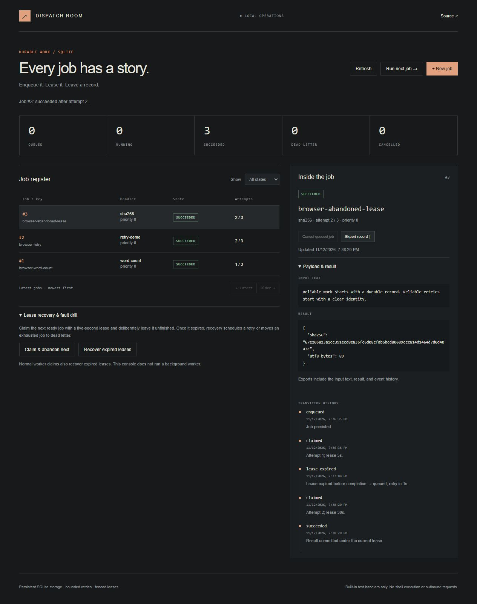

# Dispatch Room

A durable local job queue with a compact operations console. Submit text-processing jobs, run a separate worker, inspect retries and dead letters, and demonstrate crash recovery using short abandoned leases.



The backend is real SQLite persistence, not a browser simulation. Jobs and event records survive server restarts. Built-in handlers count words, hash UTF-8 text, or deliberately fail a chosen number of attempts to demonstrate retry behavior.

## Run

Python 3.11+; no runtime packages or credentials required.

```sh
python run.py --port 8000
```

Open http://127.0.0.1:8000. Create a job, then click **Run next job** to process one ready item. The console does not automatically start a worker or poll for updates; use Refresh to inspect changes made by other workers.

For continuous processing, open another terminal:

```sh
python worker.py
```

The worker polls once per second when idle. Ctrl+C stops it. To process at most one ready job:

```sh
python worker.py --once
```

Both programs default to `data/dispatch.sqlite3` beside their source files. Use the same explicit `--db /path/to/queue.sqlite3` for both to choose another database. Keep the database on a local filesystem. Runtime databases and their WAL files are excluded from Git.

## Useful demonstrations

1. **Idempotency:** submit a job with a chosen key. Submit the same request and key again; the original job is returned. Changing any normalized job option while retaining the key returns a conflict. Keys remain reserved even after success or cancellation.
2. **Retries:** choose Retry demonstration. By default it fails once, waits one second, and succeeds on its second attempt. The worker handles waiting automatically; manual runs report when no work is ready.
3. **Dead letters:** choose Retry demonstration with more injected failures than the attempt budget. Exhausted jobs enter `dead` and cannot be claimed again. Submit a new job with a new key to deliberately start a fresh budget.
4. **Lost worker:** create a job, expand Lease recovery & fault drill, and click Claim & abandon next. Wait five seconds, then recover expired leases. The failed attempt consumes its budget and schedules a retry, or dead-letters the job if exhausted.
5. **Priority and delay:** higher priority wins among eligible jobs. Future-dated jobs are not eligible, regardless of priority.

## State and durability guarantees

```text
queued ──claim──> running ──complete──> succeeded
   │                │
 cancel          fail / lease expiry
   │                ├──budget remains──> queued (backoff)
   v                └──budget spent────> dead
cancelled
```

Every mutation uses a SQLite `BEGIN IMMEDIATE` transaction. Claim selection and the transition to `running` commit together. Each claim increments attempts and receives a fresh random lease token. Completion, failure, and heartbeat require the current token and an unexpired lease. An old worker cannot commit a result after expiry or after a newer attempt has claimed the job.

This provides **at-least-once attempt semantics**, not exactly-once execution. A worker can perform computation and crash before committing its result. A later attempt may repeat that work. The shipped handlers have no external side effects; any future handler that sends messages or changes another system would need its own idempotency strategy. Enqueue deduplication is separate from execution semantics.

Normal leases last 30 seconds. The queue library exposes heartbeat renewal for longer-running custom integrations; the shipped bounded text handlers do not need it. Expired leases are recovered on the next claim or explicit recovery action, not by an autonomous timer. Backoff after attempt N is `min(60, 2 ** (N - 1))` seconds. There is no jitter in this local demonstration.

SQLite uses WAL mode, foreign keys, and a five-second connection timeout. Busy/unavailable database errors return HTTP 503. Multiple worker processes can share a local database; SQLite still serializes writers. Scheduling and leases use the host's wall clock, so clock jumps affect deadlines. This is a local teaching and development app, not a distributed production queue.

## Handlers and bounds

| Handler | Result |
| --- | --- |
| `word-count` | Unicode word-like token count, unique count, character count, and ten most frequent tokens. Lowercases text; uses a documented regex, not language-specific tokenization. |
| `sha256` | SHA-256 digest and byte count of the exact UTF-8 input. No newline or whitespace normalization. |
| `retry-demo` | Deliberate failures for the configured initial attempts, then the supplied message and successful attempt number. |

Limits: 2,000 jobs per database, 20,000 text characters, 1–8 attempts, priority 0–9, delay 0–3,600 seconds, and 80-character idempotency keys. The API caps request bodies at 160 KB. There is no purge endpoint or automatic retention policy. For a new bounded experiment, choose a new database path and keep the existing database as an archive.

The list API uses an ID cursor and omits text/results; detail requests return payload, result, and ordered events. Exported job records include those fields. Lease tokens and request fingerprints are never returned by public inspection routes.

## Local API boundary

The server binds to `127.0.0.1` and accepts only its loopback Host names and port. It rejects cross-site fetches and mismatched Origins. Mutations require a per-server request token obtained from `/api/session`, plus a bounded JSON body. This token is a local browser request guard, **not user authentication**. There is no multi-user authorization, TLS termination, or production deployment configuration. Do not expose the server as a public service.

Only three static interface assets are served. The database, Python files, and Git metadata are not web-accessible. Built-in handlers never execute shell commands, evaluate user code, or make outbound requests.

See [API.md](API.md) for endpoint contracts and a complete standard-library client example.

## Verify

```sh
python -m unittest discover -s tests -v
node --check app.js
```

The 17 Python tests cover concurrent enqueue deduplication, exclusive claims across connections, stale-worker fencing, heartbeat boundaries, retry timing, dead-letter exhaustion, persistence, cancellation, cursor pagination, Unicode limits, API validation, browser request guards, and a separate worker subprocess consuming the shared database. Tests use temporary databases and an injected clock where timing matters.

GitHub Actions runs Python 3.11/3.13 on Linux and Windows and checks JavaScript syntax with Node 22. Browser verification covers job creation, execution, duplicate submission, retry success, and the abandoned-lease recovery flow.

## Structure and references

- `queue_store.py`: durable state machine, transactions, handlers, and one-job execution.
- `worker.py`: independent worker process.
- `run.py`: local HTTP API, request validation, and static asset serving.
- `app.js`, `index.html`, `style.css`: console, inspector, and composer.

The transaction design follows SQLite's [transaction behavior](https://www.sqlite.org/lang_transaction.html) and [WAL documentation](https://www.sqlite.org/wal.html). Transactions and token checks protect the database state; they do not turn arbitrary external side effects into exactly-once operations.
